# AirPipe

Send a file to any device by sharing a passphrase. It streams straight from one machine to the other, encrypted end to end. The relay that connects the two ends only handles encrypted data.



**Try it:** [airpipe.sanyamgarg.com](https://airpipe.sanyamgarg.com)

## How it works



The sender picks a file and gets a passphrase like `RIVER FALCON MARBLE 42`. The receiver enters it on the website, in the terminal (`airpipe download RIVER FALCON MARBLE 42`), or by scanning the QR. The file then transfers directly between the two devices, encrypted the whole way.

If the receiver is offline, the sender can use **mailbox** mode: the relay holds the encrypted file for 10 minutes until it's picked up. Same passphrase either way. The receiver never has to know which mode was used.

## Getting past NAT

Two devices on home or office networks usually can't reach each other directly. Each one sits behind a router doing NAT, which drops connections it didn't expect, so neither side can just dial the other.

AirPipe gets around this the way peer-to-peer normally does. Both devices open an **outbound** connection to the relay (outbound traffic passes through NAT freely), and the relay introduces them. Over that channel they run a short **handshake**, trading their public addresses and candidate routes until they find a path that punches through both NATs. Once it's open the file flows **directly** between them and the relay drops out.

If the NATs are too strict to punch through, the transfer falls back to the relay, which forwards the encrypted bytes. They stay encrypted with the key derived from the passphrase.

## Self-host

```bash
docker run -p 8080:8080 ghcr.io/sanyam-g/airpipe-relay
```

One Go binary, ~15 MB image, bundling the web UI and install script. Or clone and `docker compose up -d` (ships an opt-in Watchtower auto-updater).

Point the CLI at your relay with `export AIRPIPE_RELAY=https://your-server.example` (or `--relay` per call). Tunables, all optional:

| Var | Default | Notes |
|---|---|---|
| `PORT` | `8080` | |
| `AIRPIPE_ALLOWED_ORIGINS` | same-origin | Extra origins if pages serve from another domain. `*` = any. |
| `AIRPIPE_RATE_LIMIT_PER_MIN` | `60` | |
| `AIRPIPE_MAX_UPLOAD_MB` | `500` | Mailbox size cap. |
| `AIRPIPE_FILE_EXPIRY` | `10m` | Mailbox expiry (Go duration). |
| `AIRPIPE_MINIMAL_UI` | off | Serve just the send/receive page at `/` instead of the full site. |
| `AIRPIPE_PUBLIC_STATS` | off | Expose `/metrics` and live stats in `/health` publicly. |
| `AIRPIPE_TRUST_PROXY_HEADERS` | off | Rate-limit by `Cf-Connecting-Ip` / `X-Forwarded-For`. Set only behind a proxy that strips client-sent copies; required behind a tunnel, or every visitor shares one limit. |

`/health` (JSON) always reports the relay's limits, which the web UI reads, and its protocol version, which the CLI checks before each transfer. Uptime, active-file counts, and Prometheus `/metrics` stay private unless you set `AIRPIPE_PUBLIC_STATS`.

## CLI

```bash
curl -sSL https://airpipe.sanyamgarg.com/install.sh | sh
brew install sanyam-g/airpipe/airpipe
go install github.com/Sanyam-G/Airpipe/v5/cmd/airpipe@latest
```

Linux, macOS, Windows (amd64 + arm64). Self-update with `airpipe update`, or `brew upgrade airpipe` if you installed with Homebrew.

v5 changed how a passphrase becomes a key, so v5 can't exchange files with v4 or older, and a v5 relay turns older clients away with a message to update. Update both ends.

```bash
airpipe send report.pdf              # prompts: direct (P2P) or mailbox
airpipe send file1.txt photos/       # multiple files / folders auto-zip
airpipe download RIVER FALCON MARBLE 42
airpipe receive ./downloads          # wait for someone to send to you; prints a QR
```

## Browser to browser

Open [`/live`](https://airpipe.sanyamgarg.com/live) for a passphrase + QR, no install on either side. The receiver enters it at the homepage and the file transfers between the two browsers.

## Encryption

Files are encrypted with NaCl secretbox (XSalsa20-Poly1305, 256-bit key). The direct path also runs inside WebRTC's DTLS.

A passphrase is four words from a 1024-word list plus a number from 10 to 99, about 10^14 possibilities. The CLI and the browser both run it through PBKDF2-HMAC-SHA256 with 600,000 iterations and a fixed salt, then split the result with HKDF into the encryption key and the room tokens. The browser uses WebCrypto for this. Each transfer derives them once, which takes well under a second on a laptop.

The relay sees a room token, both IP addresses, sizes and timing, and the ciphertext of mailbox and relayed transfers. It never receives the key. Links and QR codes carry the key after the `#`, and browsers don't send that part to the server. The key in a link is the same one the passphrase produces.

The token comes from the passphrase, so whoever runs the relay can still guess passphrases offline and check each guess against the token. Each guess costs a full PBKDF2 run. On one high-end GPU, trying every passphrase takes on the order of 200 years, about 100 on average. An attacker with many GPUs and a specific target can still get there. For files that need more than that, use a relay you run or trust. A PAKE handshake, which would stop offline guessing, is planned.

## Stack

Go relay (gorilla/websocket, pion/webrtc), embedded HTML/CSS/JS frontend (tweetnacl.js in the browser), Docker, optional Cloudflare Tunnel. Single static binary.

## Star History


## License

MIT
